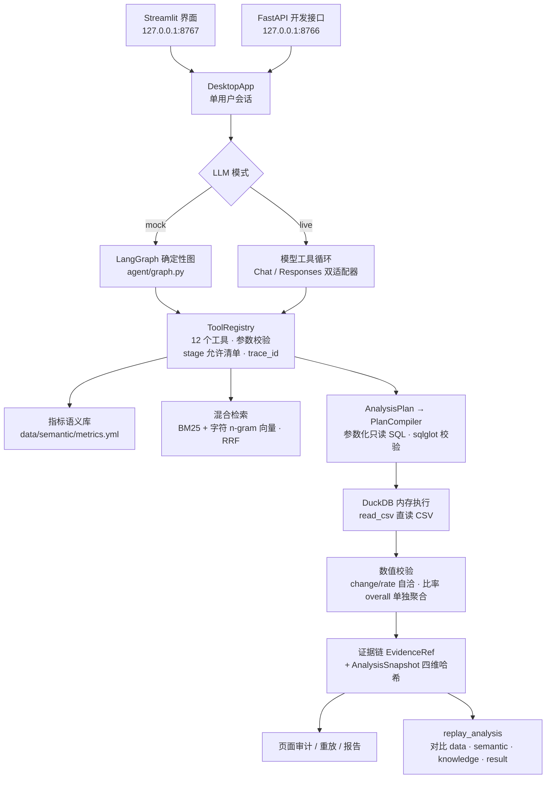

# DataPilot Verify

**一个可审计的本机经营分析 Agent。** 用自然语言问订单/门店数据，模型只负责规划和叙事，数字来自受控 SQL / Python 执行；每次分析落一条快照，带 SQL、数据哈希、口径版本和结果哈希，可以原样重放核对。

> 个人项目，不是生产系统：本机单用户、只绑 `127.0.0.1`、无鉴权、无多租户、没做过并发压测。边界在[第 9 节](#9-已知限制)写清楚了。

## 1. 它解决什么问题

让大模型分析经营数据，"能不能答"早就不难，难的是**答完敢不敢用**：

| 疑问 | 这里的做法 |
| --- | --- |
| 这个数字怎么算出来的？ | 模型不写 SQL。它产出结构化 `AnalysisPlan`，由 `PlanCompiler` 编译成参数化只读 SQL，再用 `sqlglot` 校验只允许单条 `SELECT`；结果行 JSON 序列化（键排序）后取 SHA-256 作为 `result_hash` |
| 换一天/换个人再问，结论还一样吗？ | 每次分析写 `AnalysisSnapshot`：数据文件哈希 + 指标口径版本 + 知识库版本 + plan + SQL + `result_hash`。重放时按原 plan 重跑，逐项对比 data / semantic / knowledge / result 四个维度 |
| 大家说的"销售额"是同一个口径吗？ | 指标定义集中在 `data/semantic/metrics.yml`，模型必须通过 `resolve_metric` 查询；口径回答必须引用知识文档；遇到多口径词时工作流会中断，让用户先确认口径 |

一句话：卖点不是"AI 很聪明"，而是 **AI 给出的每个数都能追到 SQL 和数据版本**。

## 2. 五分钟跑起来

### 2.1 安装环境

在仓库根目录执行，二选一：

**conda（推荐，`environment.yml` 已固定 Python 3.11）**

```powershell
conda env create -f environment.yml
conda activate datapilot-verify
```

**venv**

```powershell
python -m venv .venv
.venv\Scripts\activate            # macOS / Linux: source .venv/bin/activate
pip install -e ".[full]"
```

要求 Python 3.11（`pyproject.toml` 限定 `>=3.11,<3.13`；开发验证用的是 3.11.16）。

### 2.2 配置（可以跳过）

不写任何配置也能跑：默认就是 **mock 模式**，走本地确定性工作流，不调用模型 API，不产生费用。想自定义时：

```powershell
Copy-Item .env.example .env
```

`.env` 常用项：

| 变量 | 默认 / 示例 | 说明 |
| --- | --- | --- |
| `DATAPILOT_LLM_MODE` | `mock` | `mock` 用确定性 LangGraph 图；`live` 调真实模型 |
| `DATAPILOT_LLM_MODEL` | `deepseek-chat` | 模型名 |
| `DATAPILOT_LLM_BASE_URL` | `https://api.deepseek.com` | OpenAI 兼容端点 |
| `DATAPILOT_LLM_API_KEY` | 空 | `live` 模式必填 |
| `DATAPILOT_MAX_TOOL_STEPS` | `8` | 单次分析的工具步数预算 |

`.env` 已在 `.gitignore` 中，不会被提交。Key 只放在 `.env`。

### 2.3 启动界面

从**仓库根目录**执行（`webapp` 不是安装包，需要在根目录下导入）：

```powershell
python -m streamlit run webapp/streamlit_app.py --server.address 127.0.0.1 --server.port 8767
```

浏览器打开 <http://127.0.0.1:8767>。首次启动会自动把 `data/sample/` 下的样例数据补到 `workspace/`，并在 `artifacts/` 下创建快照和报告目录；这两个目录都在 `.gitignore` 里。启动窗口保持运行，退出按 `Ctrl+C`。

### 2.4 问一个问题

页面默认问题就是 **“7 月净销售额为什么下降？”**，点“开始分析”。mock 模式下会依次执行：解析指标 → 检索口径文档 → 编译并执行 SQL → 按区域做贡献拆解 → 数值校验 → 写快照。

侧边栏也可以“上传 CSV / Excel”替换 `orders` 或 `stores` 数据；样例数据不会被覆盖。

### 2.5 切到 live 模式

在 `.env` 里写：

```dotenv
DATAPILOT_LLM_MODE=live
DATAPILOT_LLM_MODEL=deepseek-chat
DATAPILOT_LLM_BASE_URL=https://api.deepseek.com
DATAPILOT_LLM_API_KEY=sk-...
```

live 模式下由模型决定调哪些工具、失败后如何自纠；工具层、SQL 策略、校验、快照、重放与 mock 完全一致，变的只是“谁来决策”。缺 Key 会直接报错，**不会静默降级成 mock**（BUG-018）。

## 3. 一条结论长什么样

对样例数据（合成）问“7 月净销售额为什么下降？”，Golden 期望值在 `data/golden/expected_metrics.json`：

- 2026-07 净销售额 **798,458**，环比 **-110,173**（**-12.13%**）
- 区域贡献：华东 **-113,950**（占降幅 91.2%）、华南 +9,753、华北 +4,992、西南 -10,968
- 页面同时给出：4 行区域明细表、贡献柱状图、“执行审计”（每次工具调用的成败）、快照 ID

右侧“执行审计”面板里：

- 点 **重放** → 按原 plan 重跑，显示“重放一致”，四个维度的 `changes` 全为 `false`
- 点 **下载报告** → 导出 Markdown 报告（结论、明细、SQL、哈希、证据）
- “证据引用”“原始结果”两个折叠面板可以逐条核对

> 贡献拆解是数值分解，回答“哪个区域贡献了多少降幅”，不是因果推断。

## 4. 架构与执行链路



分层职责与设计取舍见 [`docs/ARCHITECTURE.md`](docs/ARCHITECTURE.md)；一次请求的时序和路由分支见 [`docs/RUNTIME_LOGIC.md`](docs/RUNTIME_LOGIC.md)。

### 4.1 为什么模型不直接写 SQL

- 模型只产出 `AnalysisPlan`（`src/datapilot_verify/domain/models.py`）：指标、期间、维度、比较方式等字段，Pydantic 强校验（期间不重叠、维度白名单、贡献分析必须带 comparison）。
- `PlanCompiler`（`src/datapilot_verify/compiler/`）把 plan 编译成带参数的只读 SQL，不是把模型输出拼进 SQL 字符串。
- 执行前再由 `sqlglot` 校验：只允许单条 `SELECT`，写操作关键字进黑名单。
- 执行结果的哈希和 SQL 一起进快照，事后能复核每条数字的来源。

### 4.2 快照里存了什么

`AnalysisSnapshot`（`src/datapilot_verify/domain/models.py`）字段：

`snapshot_id` · `created_at` · `question` · `dataset_hashes`（orders / stores 的 SHA-256）· `semantic_version` · `knowledge_version` · `plan` · `tool_trace_ids` · `sql` · `python_code` · `result_hash` · `verification` · `replay_level`

重放走 `src/datapilot_verify/tools/artifacts.py` 的 `replay_analysis`：按原 plan 重新执行，返回四个维度的差异——数据文件变没变、指标口径变没变、知识库变没变、结果哈希变没变。任何一项变化都会让 `identical` 变成 `false`，避免“看起来一样、其实换了数据”。

### 4.3 工具层是唯一入口

所有工具调用都走 `ToolRegistry.execute()`（`src/datapilot_verify/tools/base.py`）：stage 允许清单 → Pydantic 参数校验 → 执行 → 异常归一。结果要么 `ok=True`，要么带六种错误码之一：`BAD_PARAMS` / `NOT_FOUND` / `POLICY_BLOCKED` / `EXECUTION_FAILED` / `TIMEOUT` / `INTERNAL`，模型据此自纠。

注册的 12 个工具（`src/datapilot_verify/app.py` 的 `build_registry()`）：

`inspect_dataset`、`register_dataset`、`define_relationship`、`resolve_metric`、`search_metric_docs`、`run_analysis`、`run_python_analysis`、`analyze_contribution`、`get_evidence`、`replay_analysis`、`make_chart`、`export_report`

### 4.4 Python 工具不是裸 `exec`

`run_python_analysis` 先过 `PythonPolicy`：AST 检查导入白名单、调用黑名单、禁用 dunder；真正执行在 `sys.executable -I` 子进程里，最小环境变量、15 秒超时，结果通过标记行取回。它是 **best-effort 沙箱**，不是安全边界（见[第 9 节](#9-已知限制)）。

## 5. 质量证据

下面每个数字都能在仓库里找到出处，也可以自己复现：

| 指标 | 当前值 | 出处 | 复现 |
| --- | --- | --- | --- |
| 回归测试 | **87 passed** | `tests/`（24 个测试文件） | `python -m pytest` |
| Golden Set | **8/8**，四个子指标均为 1.0 | `src/datapilot_verify/eval/runner.py`：4 个指标解析 + 3 个检索 + 1 个端到端贡献分析；期望值在 `data/golden/expected_metrics.json`；断言在 `tests/test_eval_runner.py` | `python -m datapilot_verify.eval.runner` |
| 已记录问题 | **26 个** | `docs/BUGLOG.md` 汇总表；`docs/bugs/` 下 26 个档案 | 打开 BUGLOG |
| 内置工具 | **12 个** | `src/datapilot_verify/app.py` 的 `build_registry()` | — |
| 样例数据 | **3,123 行订单 / 11 家门店** | `data/sample/orders.csv`、`data/sample/stores.csv`；生成脚本 `scripts/generate_sample_data.py`（seed `20260830`） | 看 CSV，或重跑生成脚本 |

几条说明：

- Golden Set 是离线评测：固定问题集，分别检查指标解析是否正确、检索是否命中、执行结果是否等于期望值、回答里的数字是否忠于执行结果。
- “87 passed” 是当前提交在本机 Python 3.11.16 上的结果；测试不依赖网络和 API Key。
- BUGLOG 记录的是开发中真实踩到的问题（环境、协议兼容、聚合口径、沙箱策略等），不是装饰。

## 6. 目录结构

```
datapilot-verify/
├─ data/                    指标语义库、知识文档、样例数据、Golden 期望值（只读资产）
├─ docs/                    架构、运行逻辑、BUGLOG 与 26 个问题档案
├─ scripts/                 样例数据生成、演示与启动脚本
├─ src/datapilot_verify/
│  ├─ agent/                mock 图、live 工具循环、脚本化代理、期间解析
│  ├─ tools/                12 个工具、ToolRegistry、快照与重放
│  ├─ compiler/             AnalysisPlan → 只读 SQL
│  ├─ engine/               DuckDB 执行与贡献拆解
│  ├─ verification/         数值自洽校验
│  ├─ sandbox/              Python 策略与隔离子进程
│  ├─ rag/                  BM25 + 哈希向量混合检索
│  ├─ semantic/             指标语义库加载与版本
│  ├─ evidence/             证据与快照存储
│  ├─ data/                 数据集画像与注册表
│  ├─ domain/               Pydantic 契约
│  └─ eval/                 Golden Set 评估
├─ tests/                   87 个回归用例
├─ webapp/                  Streamlit 界面、桌面服务、开发用 FastAPI、旧演示页
├─ workspace/               业务数据（运行时生成，gitignore）
└─ artifacts/               快照、报告、LangGraph 检查点（运行时生成，gitignore）
```

## 7. 常用命令

```powershell
# 回归测试（87 passed）
python -m pytest

# Golden Set（8/8；结果同时写到 artifacts/eval/latest.json）
python -m datapilot_verify.eval.runner

# 查看当前生效配置（不会打印 API Key）
python -m datapilot_verify.cli --show-config

# 开发联调 API（127.0.0.1:8766，Swagger 在 /docs）
uvicorn webapp.api:app --host 127.0.0.1 --port 8766

# 重新生成样例数据（seed 固定，结果可复现；会重写 data/sample 与 data/golden）
python scripts/generate_sample_data.py
```

Windows 上还有 `scripts\start_desktop.ps1`（启动界面）和 `scripts\demo_start.ps1`（演示：健康检查 → 启动 → 打开浏览器）。

## 8. 数据格式与口径

两张表，列名固定（额外列可以保留）：

| 表 | 必需列 | 说明 |
| --- | --- | --- |
| `orders` | `order_id`, `paid_at`, `store_id`, `category`, `channel`, `paid_amount`, `refund_amount` | 订单明细，一行一单 |
| `stores` | `store_id`, `region`, `city` | 门店维表 |

支持上传 CSV / XLSX / XLS：Excel 在本地转成 UTF-8 CSV，覆盖 `workspace/orders.csv` 或 `workspace/stores.csv`；`data/sample/` 不会被修改。缺字段会明确报错。

指标定义在 `data/semantic/metrics.yml`。改口径不需要改代码，但会改变 `semantic_version`，从而让历史快照的重放结果显式暴露差异。

## 9. 已知限制

- **单机单用户**：只监听 `127.0.0.1`，没有账号、权限隔离、租户概念，也没有多用户会话。
- **没有并发/压测**：DuckDB 是单进程内存连接，Streamlit 单实例；没做过并发或大数据量压测。
- **Python 沙箱是 best-effort**：AST 黑白名单 + `-I` 子进程 + 超时能挡住常见误用，挡不住蓄意攻击；残余绕过面见 `docs/ARCHITECTURE.md` 的“安全边界清单”。
- **live 模式会把问题发给模型服务商**：默认 mock 不联网；切 live 后问题文本和必要的工具上下文会发到你配置的端点。
- **数据面固定**：目前只支持订单 + 门店两张表，不是通用 BI；换 schema 需要改语义库和画像逻辑。
- **平台**：主要在 Windows + Python 3.11 上验证；PowerShell 脚本是 Windows 专用。macOS/Linux 理论可用，未系统验证。
- **样例数据是合成的**：seed `20260830`，用于演示和测试，不代表真实业务。
- **贡献拆解不是因果推断**：它只回答“哪个维度贡献了多少数值变化”，不回答“为什么”。

## 10. 开发环境（我的本机）

以下是我的开发机配置，克隆者按第 2 节操作即可，不需要一致：

- 路径：`D:\datapilot-verify`（原 `D:\agent-gpt`，改名后路径已全部同步）
- Python：项目内前缀环境 `.conda-env`，3.11.16
- 系统：Windows 11 + PowerShell
- `.env`：live 模式（DeepSeek），本地保存、不入库
- 常用：`scripts\start_desktop.ps1` 启动界面，`scripts\demo_start.ps1` 一键演示

## 11. 常见问题

- **8767 打不开**：确认启动窗口还在运行；用 `netstat -ano | Select-String ':8767'` 看端口是否被占用。
- **live 模式报缺 Key**：`.env` 必须在仓库根目录且 `DATAPILOT_LLM_API_KEY` 有值；修改后重启。程序不会静默改用 mock。
- **上传报缺字段**：按第 8 节的列名修正表头。
- **想恢复样例数据**：删掉 `workspace/` 下对应 CSV，重启后会自动从 `data/sample/` 补回。
- **只想看不联网的版本**：不建 `.env`，或把 `DATAPILOT_LLM_MODE` 设为 `mock`。

## 12. 文档

- [`docs/ARCHITECTURE.md`](docs/ARCHITECTURE.md)：分层架构、关键设计决策与取舍
- [`docs/RUNTIME_LOGIC.md`](docs/RUNTIME_LOGIC.md)：一次请求的完整时序与路由分支
- [`docs/BUGLOG.md`](docs/BUGLOG.md)：26 个问题的汇总表，细节在 `docs/bugs/`

## 13. License

MIT，见 [`LICENSE`](LICENSE)。
